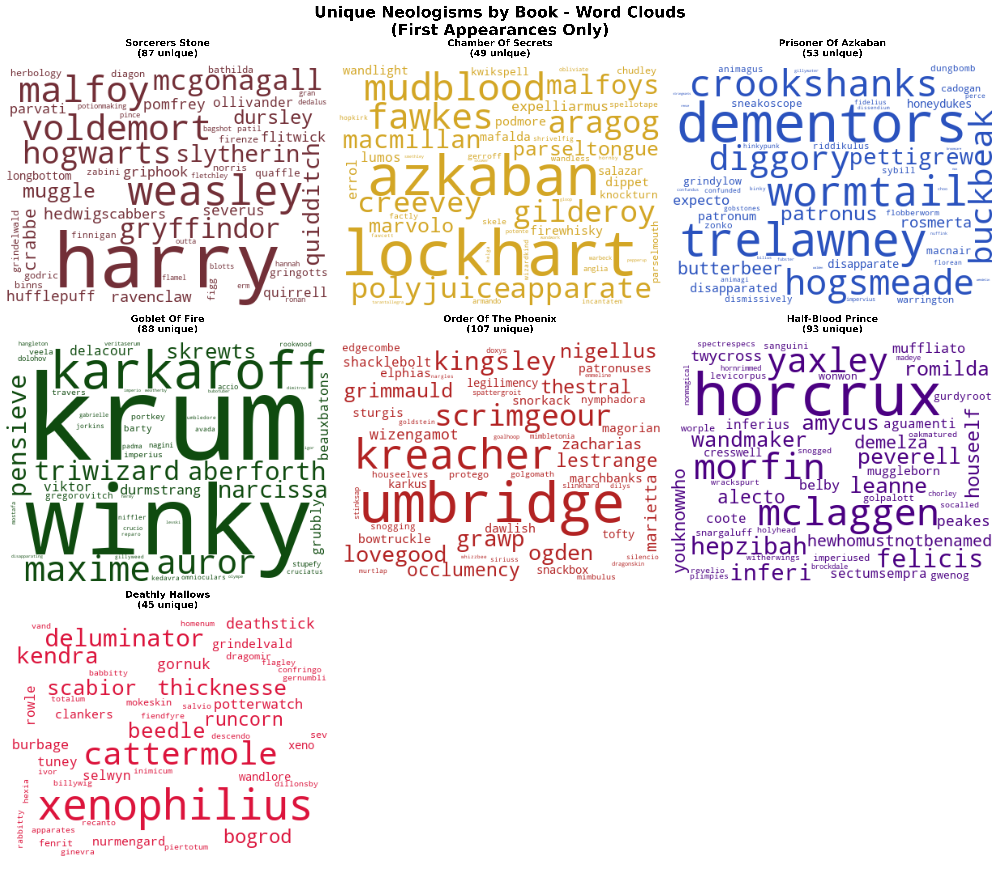
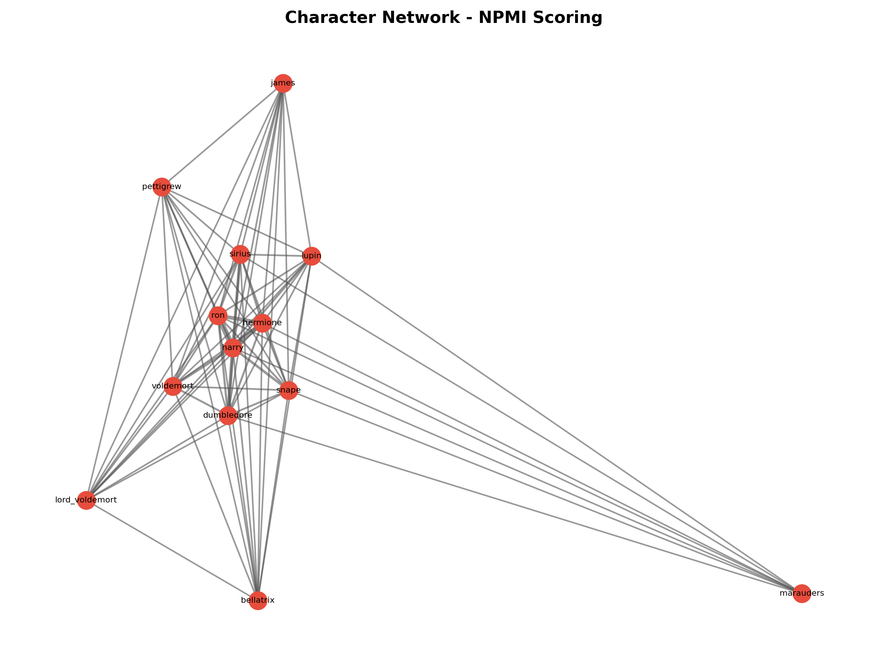
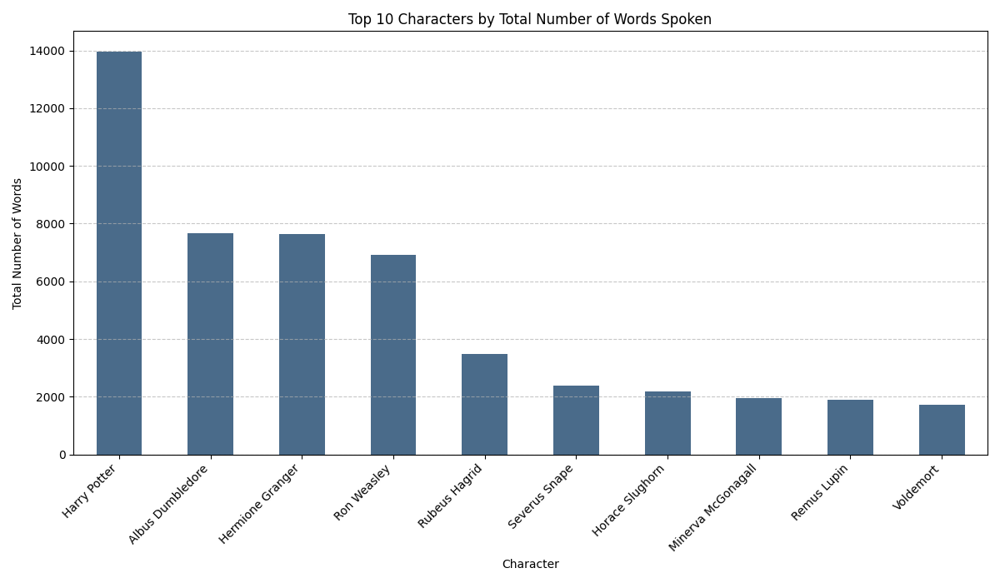
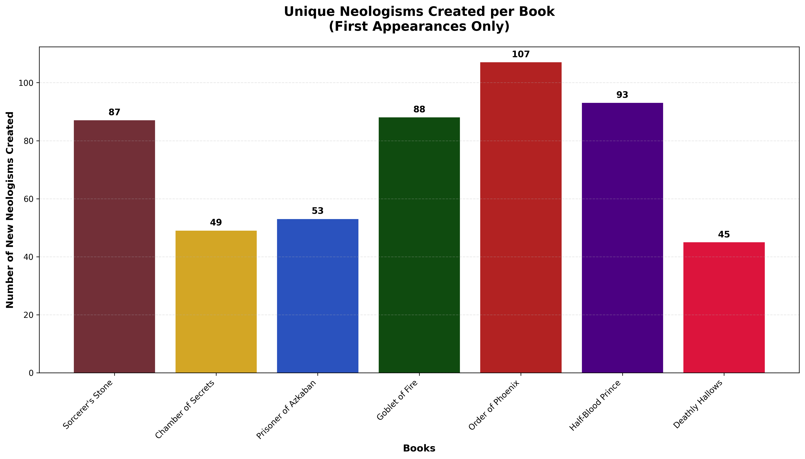

# Harry Potter — Text & Character Network Analysis

A data-science exploration of the seven *Harry Potter* books: who talks the most, who appears with whom, and how J.K. Rowling's invented vocabulary grows from book to book.

<p align="center">
  
</p>

## Highlights

| | |
|---|---|
| **Character network** — characters become nodes, and two characters are linked when they are mentioned close to each other in the text. Links are scored two ways: a **Gaussian distance kernel** and **NPMI** (normalized pointwise mutual information) over sliding windows. |  |
| **Dialogue statistics** — words spoken per character across the series, plus house and blood-status distributions. |  |
| **Neologism hunt** — detects words that don't exist in standard English (spells, creatures, places…) and tracks the book in which each first appears. |  |

## How it works

1. **Retrieval & cleaning** (`retrieval_and_cleaning.py`) — downloads the books, characters and dialogue datasets from Kaggle with `kagglehub`, fixes spacing artefacts and splits each book into chapters.
2. **Frequency analysis** (`frequency_analysis.py`) — tokenizes the text, removes stop words with NLTK and compares the most frequent words per book (word clouds of the first vs. last book).
3. **Character network** (`character_network/`)
   - `core.py` finds every character mention (with aliases) and stores their token positions in `Artifacts/mentions.parquet`;
   - `scoring.py` builds weighted edges, either with a distance kernel `exp(-d² / 2σ²)` or with NPMI computed over 200-token sliding windows;
   - `viz.py` draws the graphs with NetworkX.
4. **Neologisms** (`neologism/`) — filters out dictionary words and named entities to isolate invented vocabulary, then plots its timeline across the series.
5. **Tests** (`tests/`) — unit tests for the scoring functions and the network pipeline, run with `pytest`.

## Getting started

```bash
pip install -r requirements.txt pyarrow networkx pytest
python main.py                                  # download and prepare the datasets
python -m character_network.pipeline            # mentions -> kernel & NPMI edge lists (Artifacts/)
python neologism/main.py                        # neologism analysis and visualizations
pytest                                          # run the tests
```

A Kaggle account is needed the first time, so that `kagglehub` can download the datasets.

## Tech stack

Python · pandas · NLTK · NetworkX · Matplotlib · Seaborn · WordCloud · pytest

## Authors

Built by **Samuel Hayat** and **Nitzan Ventura** as the final project of the *Introduction to Data Science* course at the Hebrew University of Jerusalem.
